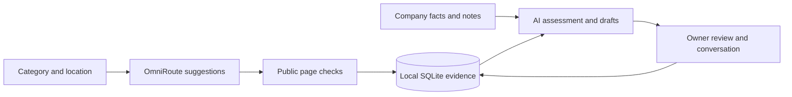

# SSLSOL ClientDesk

A local workspace for researching SMB prospects, reviewing service fit and preparing client conversations. Built for SSLSOL IT infrastructure, cybersecurity, ERP, AI systems, automation and business services. Elancebot has a separate profile and pipeline.

Inspired by the [Clair interview](https://www.youtube.com/watch?v=v0eruAaxqaQ): company context supports research and drafts while people lead relationships. Independent implementation; Clair's private Talos system is not included.

## Features

- Editable regional campaigns for Pakistan, the Middle East, USA and Europe.
- Persistent background discovery: AI suggestions followed by public-page checks, up to ten candidates per job.
- Website evidence, timestamps, published contact routes and rejection reasons.
- AI service-fit assessment with observations, hypotheses, questions and unknowns.
- Four OmniRoute drafts plus instant templates: introduction, follow-up, meeting brief and pilot outline.
- Company facts, relevant knowledge, notes, follow-ups, manual stages and activity history.
- CSV intake/export, JSON backups, additive recovery and preserved opt-outs.

**A candidate is not a verified buyer.** Identity, location, business size and interest need review. Search execution is unverified unless the gateway supplies citations. No outreach is sent automatically.

## Quick start

Requires Python 3.11+ and an existing [OmniRoute](https://github.com/diegosouzapw/OmniRoute) instance for AI. Core features use the Python standard library.

```powershell
git clone https://github.com/ycgiio/sslsol-clientdesk.git
cd sslsol-clientdesk
python scripts/configure_omniroute.py --from-existing
python launch.py
```

Open **http://127.0.0.1:8787**. Review and confirm the offer in Company brain before drafting. A fresh checkout has no prospect dataset. Supplied positioning is a starting configuration, not delivery proof.

`--from-existing` reads an active endpoint key from local OmniRoute without changing its permissions. Alternatively run the script without that option and enter a key privately. Process environment variables are `OMNIROUTE_BASE_URL`, `OMNIROUTE_API_KEY`, and `OMNIROUTE_MODEL`; see `.env.example`. Environment files are not loaded automatically. The alias `auto/best-free` depends on gateway access and provider quotas.

On Windows, double-click `Start ClientDesk.cmd`. The configured laptop also has a desktop shortcut. Stop from Growth playbook; OmniRoute remains separately managed.

## Data flow



The browser talks to a loopback Python service. AI runs through OmniRoute and its upstream provider; selected context leaves the laptop. One worker handles bounded discovery jobs. Interrupted scans preserve completed records.

Research respects robots.txt, validates public destinations and redirects, and limits page size. It is business research, not a vulnerability scan. Blocked or unreadable sites need manual review. A live page does not independently prove every suggested business attribute.

## Documentation

- [User guide](docs/user-guide.md): configuration, workflow, recovery and troubleshooting.
- [POC report](docs/poc-report.md): video analysis, architecture and operating limits.
- [Verification](verification.md): reproducible tests and live results.
- [Security](SECURITY.md) and [contributing](CONTRIBUTING.md).

Printable PDFs: [User guide](docs/SSLSOL-User-Guide.pdf) and [POC report](docs/SSLSOL-POC-Report.pdf). Private records, keys, logs, runtime downloads and document build outputs are excluded from Git.

## Backup and recovery

Private data is in `data/clientdesk.sqlite`; gateway configuration is in `data/config.local.json`. JSON backups exclude credentials and include profiles, prospects, knowledge, jobs and activity. Browser restore adds missing prospects and knowledge while preserving existing records, profiles and opt-outs. It saves a safety snapshot first. Full database recovery is described in the guide.

## Validation

```powershell
python -m unittest -v
python -m py_compile app.py workflows.py integrations.py launch.py scripts/configure_omniroute.py
node --check web/app.js
```

GitHub Actions runs these checks. Provider keys are unnecessary for tests. Node is only needed for the syntax check or historical browser-model experiment.

## Limits

Single-user local deployment. No public hosting, multi-user login, inbox integration, automatic outreach or guaranteed clients. SSLSOL website availability failed during setup; check DNS and hosting before sending prospects there.

The optional historical `setup_local_ai.py` utility and npm package install browser Qwen assets. The delivered UI uses OmniRoute because longer browser generation was unreliable on this laptop. Those downloads are not required for normal operation. Windows security protections remain enabled.

MIT licensed. Third-party services and optional model assets retain their own licenses and terms.
